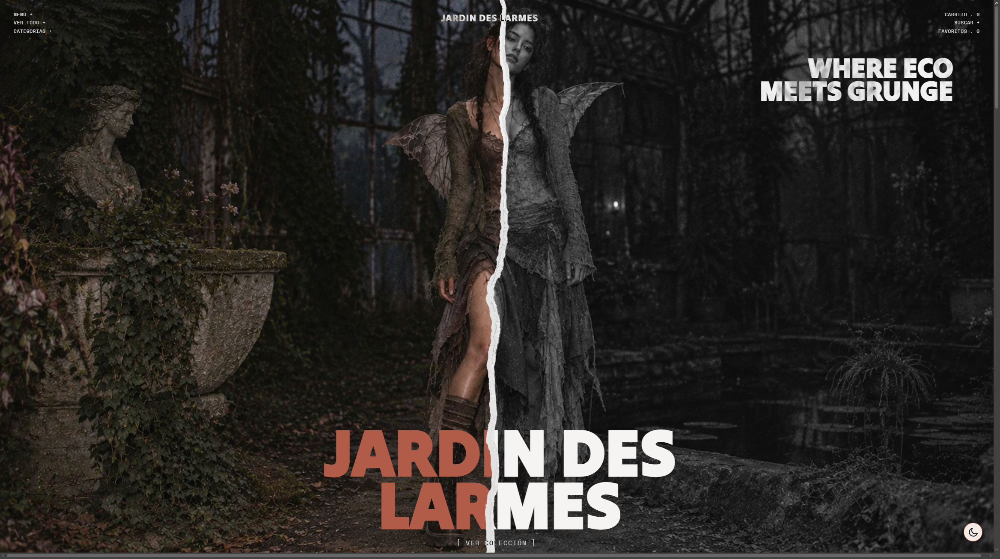

 

    
    

 

> *"Hay canciones que no se escuchan solo con los oídos, sino con toda la vida que traen dentro."*
>
> Este proyecto nace en honor a ***Jardin des Larmes***, de Till Lindemann y ZAZ, y, por encima de todo, en honor a la persona que la trajo a mi vida. Alguien a quien sigo amando con toda mi alma a día de hoy, cuya forma de mirar el mundo, sentir la música y habitar lo bello sigue inspirando cada una de mis decisiones, mi sensibilidad creativa y mi día a día.
>
> De esa historia (y de la tensión poética entre las lágrimas y la sangre, entre lo frágil y lo eterno) brota cada línea de código, cada textura rasgada y cada latido de esta interfaz.

  

**Jardin des Larmes** es una propuesta de tienda online conceptual (*ecommerce*) de moda alternativa y sostenible, diseñada y maquetada íntegramente con **HTML5, CSS3 y JavaScript Vanilla**. El proyecto fusiona dos universos estéticos opuestos pero complementarios: la fragilidad artesanal y terrosa del **Fairy Grunge** y la contundencia atmosférica del **Romantic Goth**.

Este proyecto viene del primer reto que hice en **Diseño de Interfaces Web (2º DAW)**, abarcando desde la conceptualización de marca, arquitectura de información y prototipado hasta la maquetación avanzada y validación bajo estándares W3C.

## Concepto, identidad visual y sistema dual

La marca parte de la premisa **«Where Eco Meets Grunge / Where Eco Meets Goth»**, rompiendo con los códigos visuales habituales de la ropa *eco friendly* mediante una dirección de arte editorial, orgánica y rebelde.

Para demostrar la separación total entre estructura y presentación, la web incorpora un **sistema dual de hojas de estilo** intercambiable en tiempo real mediante un botón flotante:

1. **Estética Fairy Grunge (`estilos.css` por defecto):** Tonos terracota cálidos, arena y acentos terrosos que evocan artesanía y naturaleza.
2. **Estética Atmospheric Goth (`estilos-alt.css` alternativo):** Atmósfera fría y nocturna en gris celeste con acentos rojo tinta/pasión.

### Sistema cromático

Los colores se distribuyen por función mediante variables globales en `:root` para mantener una interfaz expresiva sin recargarla y reducir la fatiga visual:

| Código Hex | Nombre / Rol | Uso en la interfaz |
| :---: | :--- | :--- |
| `#f4eae6` | **Terracota claro** (Fondo Fairy) | Fondo principal cálido que evita el blanco puro y aporta tacto terroso. |
| `#e0e4e6` | **Gris celeste** (Fondo Goth) | Fondo principal del tema alternativo; evoca algodón orgánico sin blanquear. |
| `#f5f4f3` | **Blanco claro** (Texto por inversión) | Reservado para fondos oscuros e inversión dinámica con `mix-blend-mode: difference`. |
| `#b05c49` | **Naranja terroso** (Acento Fairy) | Llamadas a la acción, garabatos SVG en *hover* y titulares de sección. |
| `#e62222` | **Rojo pasión / tinta** (Acento Goth) | Acento principal de alto contraste en el tema gótico alternativo. |

### Jerarquía tipográfica

* **Títulos y Logotipo (`Tilt Warp`):** Geométrica, condensada y contundente; aporta presencia editorial de alta costura.
* **Interfaz y Lectura (`Space Mono`):** Monoespaciada, técnica e industrial; dota de estética de archivo a la navegación, precios y descripciones.
* **Detalles Artesanales (`Patrick Hand`):** Introduce el trazo humano en la carita triste del logotipo (`:,(`) y en los mensajes cercanos del pie de página, rompiendo la frialdad digital.

## Arquitectura de información y estructura de la Web

La navegación sigue la **regla de los tres clics**, organizando la *Home* en **cinco bloques estructurales** fluidos sin tablas ni posicionamientos rígidos obsoletos:

1. **Cabecera Fija Dinámica (`<header>`):** Distribución simétrica con Flexbox y `mix-blend-mode: difference` para garantizar contraste automático sobre las fotografías del carrusel. Incluye enlaces con garabatos SVG dibujados a mano que se trazan al pasar el ratón y una animación orgánica al hacer scroll.
2. **Hero con Cubo 3D Invisible (`.seccion-portada`):** Contenedor con `perspective: 200000px` y `transform-style: preserve-3d` que rota cada 8 segundos sobre el eje X. Cada diapositiva superpone una capa base en escala de grises, una capa a color recortada con `mask-image` y una textura de papel rasgado (`papel-roto.webp`).
3. **Catálogo Fluido (`00. NOVEDADES`):** Rejilla construida con CSS Grid (`repeat(auto-fit, minmax(250px, 1fr))`) que adapta el número de columnas automáticamente a cualquier ancho de pantalla sin saturar de *media queries*, utilizando un patrón reutilizable de tarjeta de producto (`.tarjeta-producto`).
4. **Experiencia Cinematográfica (`01. JDL EN MOVIMIENTO`):** Contenedor de `300vh` con escena fija (`position: sticky`) donde un cortometraje se revela progresivamente a través de una máscara en forma de corazón (`corazon.png`) vinculada al desplazamiento vertical mediante *CSS Scroll-Driven Animations* (`view-timeline`).
5. **Footer Editorial Multicapa (`#pie-pagina`):** Composición por capas con imagen de fondo ajustada mediante `object-position: top center` para evitar cortes panorámicos, silueta central superpuesta, logotipo gigante en negativo y bloque de suscripción.

## Proceso de diseño, validación y pruebas

* **Prototipado y Wireframing:** Planificación estructural inicial en **Wireframe.cc** y desarrollo del sistema de diseño en **Figma** (componentes reutilizables y variantes de estado), descartando herramientas cerradas como Canva para mantener control real sobre CSS y accesibilidad.
* **Validación W3C CSS3 + SVG:** Durante la auditoría con el validador oficial del W3C se desglosó la propiedad abreviada `mask` en sus propiedades individuales (`mask-image`, `mask-position`, `mask-size` y `mask-repeat`) y se aislaron las propiedades experimentales de *Scroll-Driven Animations* (`view-timeline-name` y `animation-timeline`), logrando **0 errores de validación**.
* **Responsive y Accesibilidad:** Uso combinado de tipografía fluida con `clamp()`, rejillas autoajustables, `@media (max-width: 768px)` con menú hamburguesa para dispositivos móviles y soporte para `@media (prefers-reduced-motion: reduce)`.
* **Experimentación Complementaria:** Pruebas paralelas de maquetación mediante el sistema de rejilla de **Bootstrap** (`container`, `row`, `col-lg-4`) y preprocesamiento con **Sass** (variables `$color-principal` y anidamiento de selectores).

---

# Código

La arquitectura del proyecto separa estrictamente la semántica, las dos capas visuales y la interactividad sin duplicar nodos en el DOM.

Los comentarios dentro del código son todo menos profesionales, no los tomes como referencia porque es como yo entiendo las cosas y las exteriorizo para que los docentes entendieran mi proceso más visceral picando código.

## HTML

El documento `src/index.html` sigue una estructura semántica clara (`<header>`, `<main>`, `<section>`, `<article>`, `<footer>`):

* **`.texto-negativo`**: Clase transversal aplicada a elementos textuales superpuestos sobre fondos cambiantes para invertir su color dinámicamente.
* **Garabatos SVG (`<svg class="garabato">`)**: Trazados vectoriales personalizados con `pathLength="1"` incrustados en los enlaces de navegación y llamadas a la acción para permitir su animación precisa por trazo.
* **Patrón `.tarjeta-producto`**: Estructura modular pensada para escalar a futuras vistas de catálogo, favoritos o categorías manteniendo coherencia visual y de código.

## CSS

Ambas hojas (`src/estilos.css` y `src/estilos-alt.css`) comparten la misma arquitectura base y modifican los tokens visuales desde `:root`:

* **Cubo 3D en portada**: Cada `.diapositiva` se posiciona en el espacio tridimensional rotando en grados múltiplos de `-90deg` sobre el eje X y desplazándose con `translateZ(50vh)`.
* **Animación SVG en *hover***: Se juega con `stroke-dasharray: 1 1.1` y `stroke-dashoffset: 1.05` pasando a `0` con una curva `cubic-bezier(0.45, 0, 0.55, 1)` para simular un subrayado dibujado a mano al instante.
* **Temblor artesanal (`@keyframes temblor-trazado`)**: Animación escalonada (`steps(3, end)`) que da vida a la carita triste `:,(` al pasar el cursor sobre el logo y de forma permanente en el footer.

## JS

El bloque `<script>` al final de `src/index.html` gestiona tres comportamientos clave de forma limpia y nativa:

* **Rotación automática del carrusel 3D**: Un `setInterval` cada `8000ms` incrementa `anguloActual += 90` y actualiza la transformación `translateZ(-50vh) rotateX(...)`.
* **Transformación de cabecera al hacer scroll**: Escucha el evento `scroll` de `window` y alterna las clases `.desplazada` y `.desplazada-inversa` al superar los `50px`, ejecutando animaciones curvas escalonadas sobre los enlaces.
* **Diccionario de cambio de tema (`temaFairy` / `temaGoth`)**: Al pulsar `#btn-tema`, se invierte el estado booleano `esFairy` y se actualiza dinámicamente el atributo `href` de `#link-estilos`, las fotografías y títulos de las cuatro caras del cubo 3D, las prendas y nombres del catálogo, la modelo del footer y el eslogan principal (`WHERE ECO MEETS GRUNGE` / `WHERE ECO MEETS GOTH`).

Referencias, créditos visuales y aviso académico

 

Este repositorio corresponde a una práctica académica sin ánimo de lucro desarrollada en el marco del ciclo formativo de Desarrollo de Aplicaciones Web (2º DAW). Todos los recursos externos, marcas y referencias citadas pertenecen a sus respectivos autores y propietarios:

* **Inspiración de dirección de arte y estructura web:** Estética editorial, composición de vídeo con máscara vinculada al scroll y estructura multicapa del pie de página inspiradas en el universo visual de [Serotoninn](https://serotoninn.com/).
* **Referencias de moda alternativa y catálogo:** Inspiración estética y visual procedente de firmas de moda alternativa como [Disturbia](https://www.disturbia.co.uk), [Killstar](https://eu.killstar.com) y [Drop Dead](https://dropdead.world/), así como tableros conceptuales de [Fairy Grunge](https://es.pinterest.com/ideas/fairy-grunge/920643524339/) y [Romantic Goth](https://es.pinterest.com/search/pins/?q=romantic%20goth&rs=typed) en Pinterest.
* **Recursos gráficos y audiovisuales:** Las fotografías de producto, texturas de papel rasgado, máscaras y el fragmento audiovisual integrado en la sección *JDL en movimiento* se emplean exclusivamente con fines educativos y de prototipado de interfaz. La sostenibilidad se plantea como narrativa conceptual de marca sin atribuir certificaciones comerciales reales.
* **Herramientas técnicas de apoyo:** Edición de trazados vectoriales con [SVG Path Editor](https://yqnn.github.io/svg-path-editor/) y documentación de curvas de aceleración en [MDN Web Docs (`cubic-bezier`)](https://developer.mozilla.org/en-US/docs/Web/CSS/Reference/Values/easing-function/cubic-bezier).

 

> `Creado con mucho café y solecito de Cadiz` [@SugusGamberra](https://github.com/SugusGamberra)